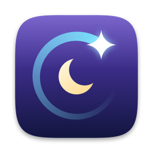
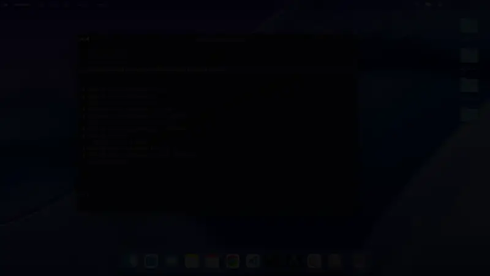
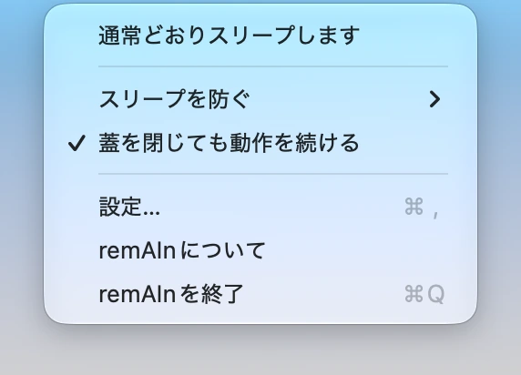
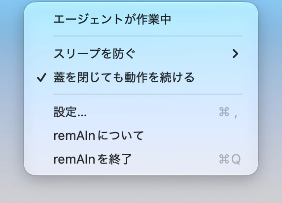
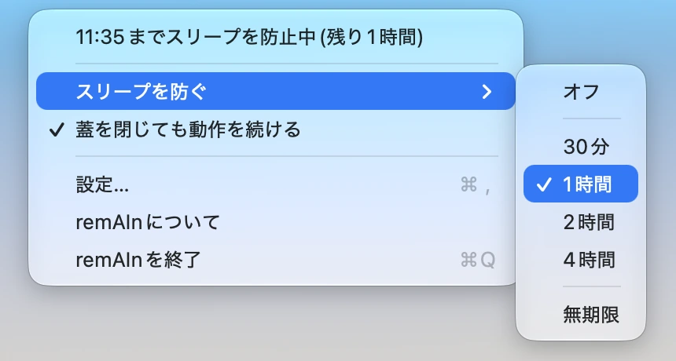
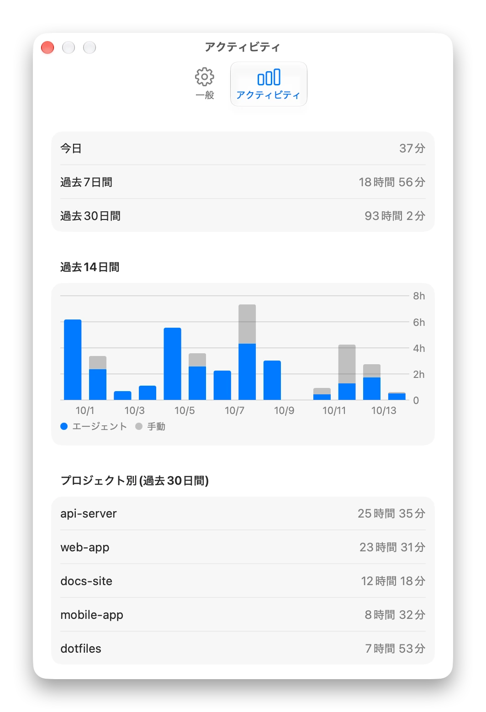
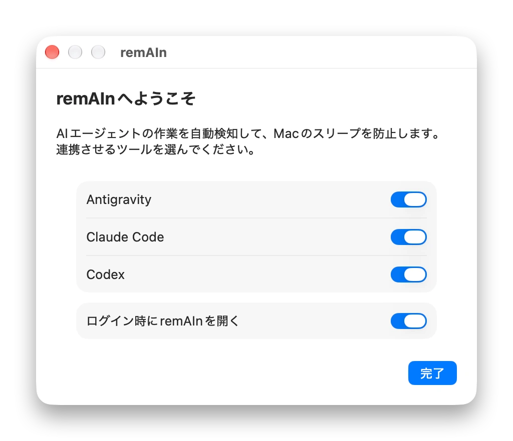
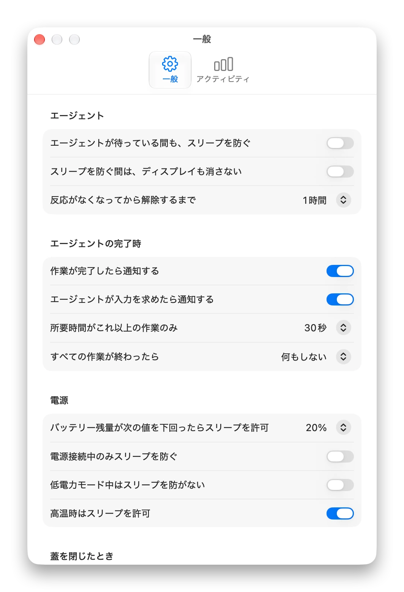
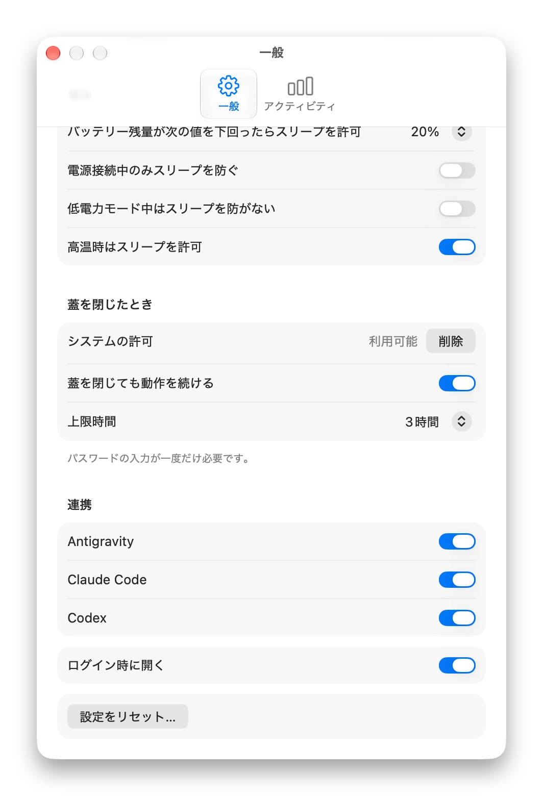
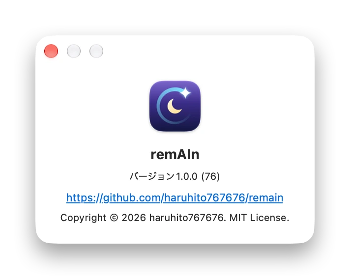

<div align="center">



# remAIn

AIエージェントが働いている間だけ、Macを起こしておく。

AIエージェントの作業を自動で見つけて、Macのスリープを防ぐ、小さなmacOSのメニューバーアプリです。<br>
止まったら、いつもどおりスリープします。スリープで作業が途切れることも、Macが何時間も起きたままになることもありません。

[](#動作環境)
[](https://github.com/haruhito767676/remain/releases/latest)
[](#ライセンス)

[ダウンロード](https://github.com/haruhito767676/remain/releases/latest) · [English](README.md) · [技術仕様書](SPEC.md)

</div>

<br>

<p align="center">

</p>

https://github.com/user-attachments/assets/a8e60886-0099-4ca5-a1d7-0cf276a63caf

---

## なぜ remAIn か

AIエージェントは、人の手を離れて、数分から数時間、作業します。Macは、それを知りません。

- **スリープで作業が止まる。** Macが眠ると、長い作業は途中で止まります。
- **`caffeinate` は、止めどきを知らない。** コマンドで包めば起きたままにできますが、始めるのも終わらせるのも手動です。忘れると、Macは一晩中起きたままで、バッテリーを使い切ります。
- **すべてのエージェントがコマンドではない。** IDEやデスクトップアプリ、バックグラウンドの作業は、コマンドで包めません。

remAInは、エージェントそのものを見ています。作業している間は起きていて、終わったとき、途中で止まったとき、いなくなったときは、すぐにいつもどおりスリープします。

## できること

### 働いている間だけ起こし、それ以外は眠らせる

<table>
<tr>
<td align="center">
<picture>
  <source media="(prefers-color-scheme: dark)" srcset="docs/media/shot-menu-idle-dark-ja.webp">
  
</picture>
<br><sub>何も動いていないとき: いつもどおり、スリープします。</sub>
</td>
<td align="center">
<picture>
  <source media="(prefers-color-scheme: dark)" srcset="docs/media/shot-menu-working-dark-ja.webp">
  
</picture>
<br><sub>エージェントが作業中: Macは起きたままです。</sub>
</td>
</tr>
</table>

エージェントは、作業を始めたとき、動いているとき、入力を待っているとき、終わったときに、それを知らせます。remAInは、その間だけMacを起こしておきます。複数のエージェントが同時に動いても大丈夫です。途中で止めたときも気づくので、中断したエージェントのせいでMacが眠れなくなることはありません。

<p align="center">

</p>

### 手動でスリープを防ぐ

remAInが見えないものには、メニューから、30分、1時間、2時間、4時間、または無期限で防げます。残り時間はメニューに出て、押すと解除できます。ターミナルからは、`remain run -- <コマンド>` で、そのコマンドが動いている間だけ防げます。

<p align="center">
<picture>
  <source media="(prefers-color-scheme: dark)" srcset="docs/media/shot-menu-submenu-dark-ja.webp">
  
</picture>
</p>


### 蓋を閉じても、動かし続ける

蓋を閉じても、エージェントは動き続けます。作業が終わると、Macはスリープします。最初に一度だけ、パスワードが必要です。安全側に倒れるように作ってあり、remAIn自体が落ちても、見張り役が通常のスリープに戻します。高温、バッテリー低下、上限時間(既定は3時間)でも、自動的に止まります。初期状態ではオフです。

<p align="center">

</p>

### 鞄の中で、バッテリーを使い切らない

バッテリー残量が少ないとき、バッテリー駆動のとき、低電力モードのとき、高温のときは、Macのスリープを許可し、その理由をお知らせします。条件が解消すれば、自動で再開します。

### 終わったら、お知らせ

作業の完了、エージェントが入力を求めたとき、エージェントが予期せず止まったとき(落ちた、窓が閉じられたなど。そのときは、remAInがMacを離します)に、通知が届きます。自分でEscを押して止めたときは、通知は出ません。すべて終わったあとに、ディスプレイを消す、Macをスリープさせる、も選べます。

<p align="center">

</p>

### 時間の行き先を見る

「アクティビティ」タブで、Macを起こしていた時間を、日ごと、プロジェクトごとに確認できます。記録はこのMacの中だけに保存され、90日で削除されます。

<p align="center">
<picture>
  <source media="(prefers-color-scheme: dark)" srcset="docs/media/shot-settings-activity-dark-ja.webp">
  
</picture>
</p>

### そのほか

- ワンクリックでつながる。ウェルカム画面で、見つかったエージェントとの連携を選べます。設定では、エージェントごとにスイッチがあります。既存の設定は、そのまま残ります。
- 自分で直る。アプリを移動しても、起動時に、連携の向き先を直します。
- 静かな初期設定。エージェントに明るい画面は要らないので、ディスプレイはスリープしてかまいません。
- プライバシー重視の設計。通信なし、アカウントなし、アクセス解析なし。詳しくは[プライバシー](#プライバシー)をご覧ください。
- 元に戻せる。ボタン1つで、remAInがMacに追加したものをすべて取り除けます。詳しくは[リセットとアンインストール](#リセットとアンインストール)をご覧ください。
- 日本語と英語。システムの言語に合わせて切り替わります。

### 画面

<table>
<tr>
<td width="50%" align="center">
<picture>
  <source media="(prefers-color-scheme: dark)" srcset="docs/media/shot-welcome-dark-ja.webp">
  
</picture>
</td>
<td width="50%" align="center">
<picture>
  <source media="(prefers-color-scheme: dark)" srcset="docs/media/shot-settings-top-dark-ja.webp">
  
</picture>
</td>
</tr>
<tr>
<td align="center"><sub>短いウェルカム画面で、エージェントとつなぎます</sub></td>
<td align="center"><sub>設定</sub></td>
</tr>
<tr>
<td width="50%" align="center">
<picture>
  <source media="(prefers-color-scheme: dark)" srcset="docs/media/shot-settings-bottom-dark-ja.webp">
  
</picture>
</td>
<td width="50%" align="center">
<picture>
  <source media="(prefers-color-scheme: dark)" srcset="docs/media/shot-about-dark-ja.webp">
  
</picture>
</td>
</tr>
<tr>
<td align="center"><sub>蓋を閉じたとき、連携、リセット</sub></td>
<td align="center"><sub>remAInについて</sub></td>
</tr>
</table>

## インストール

1. [Releases](https://github.com/haruhito767676/remain/releases/latest) から `remAIn-v1.0.0.zip` をダウンロードして展開し、remAInをアプリケーションフォルダへ移動します。
2. remAInは個人開発の無料アプリで、Appleの署名を受けていません。そのため、初回はmacOSが警告を出します。「システム設定」→「プライバシーとセキュリティ」を開いて、下へスクロールし、「このまま開く」を選んで、Touch IDかパスワードで確認してください。一度行えば、次回からは普通に起動できます。
3. ウェルカム画面が開きます。連携するエージェントを選び、ログイン時にremAInを開くかどうかを決めてください(エージェントの作業に気づくには、remAInが起動している必要があります)。

ご自身でビルドするときは、[開発](#開発)をご覧ください。

### 動作環境

| 項目 | 内容 |
|---|---|
| macOS | 14(Sonoma)以降。Apple SiliconとIntel。|
| エージェント | [対応エージェント](#対応エージェント)のうち1つ以上、または `remain run` で包んだ任意のコマンド。|

## 使い方

1. ウェルカム画面で、エージェントを連携します。あとから「設定」→「連携」で、エージェントごとにオン・オフできます。
2. いつもどおり作業します。メニューバーのアイコンが、remAInの動きを示します。エージェントが作業中はきらめき、ほかの理由でMacを起こしているときはカップ、エージェントが入力を待っているときは砂時計、スリープしてよいときは月です。
3. 単発のときは、メニューの「スリープを防ぐ」を使います。夜通しの作業には、「設定」→「蓋を閉じたとき」で、「蓋を閉じても動作を続ける」を一度設定しておきます。

### 補足

- エージェントの作業に気づくには、remAInが起動している必要があります。「ログイン時に開く」をオンにしておけば、忘れても大丈夫です。
- 触らなくてよい設定: 「反応がなくなってから解除するまで」は安全網にすぎず、「スリープを防ぐ間は、ディスプレイも消さない」は、それだけでは何もしません。
- バッテリーのないMacでは、バッテリーと蓋の設定は隠れます。
- 蓋を閉じて動かし続ける機能は、ネットワーク接続があってこそ役に立ちます(移動中はテザリングなどで)。

## 対応エージェント

| エージェント | 見守り方 |
|---|---|
| Antigravity (Google) | `~/.gemini/config/hooks.json` のフック。停止ボタンはフックも痕跡も残さないため、5分間なにも聞こえなければ終了とみなします(バックグラウンドのコマンドが動いていると伝えてきた場合を除く)。|
| Claude Code (Anthropic) | `~/.claude/settings.json` のフック(CLI、デスクトップアプリ、VS Code拡張)。Escキーでの中断や、閉じたことを検知します。|
| Codex (OpenAI) | `~/.codex/hooks.json` のフック(CLIとデスクトップアプリ)。Codexは最初に、フックの確認と信頼を求めます。また、フックは会話の作業フォルダで起動されるため、そのフォルダが存在しないと(デスクトップアプリの仮の「New project」など)、すべてのフックが `No such file or directory` で失敗します。実在するフォルダを開いてください。|
| 任意のコマンド | `remain run -- <コマンド>` で、そのコマンドが動いている間、起こしておきます。|

remAInが追加・削除するのは、自分の項目だけで、書き換える前に、初回だけバックアップを隣に残します(例: `settings.json.remain-backup`)。`remain doctor` で、どのエージェントがつながっているかを確認できます。

## よくある質問

**インターネットに接続しますか?** いいえ。[プライバシー](#プライバシー)を見てください。

**なぜmacOSが警告を出しますか?** remAInは、個人が作った無料のアプリで、Appleの署名がありません。[インストール](#インストール)の手順で、一度だけ許可してください。

**エージェントが落ちたり、窓を閉じたりしたら?** プロセスが消えたこと(または、長く無反応なこと)に気づいて、Macをスリープできる状態に戻します。作業がある程度長かったときは、エージェントが予期せず止まったことを通知します。自分でEscを押して止めたときは、何も出しません。

**`caffeinate` との違いは?** `caffeinate` は、包んだコマンドが動いている間、起こし続けるもので、始めるのは自分です。remAInは、エージェントそのものを見ていて、IDEやデスクトップアプリにも対応し、自分で手を離します。

**鞄の中でバッテリーを使い切りませんか?** バッテリー残量が少ないとき、バッテリー駆動のとき、低電力モードのとき、高温のときは、スリープを許可します。蓋を閉じたままの動作は、初期状態でオフで、上限時間もあります。

## remAInが触れるもの

remAInは、必要最小限のものにしか触れません。

| 対象 | 理由 |
|---|---|
| 各エージェントのフックの設定ファイル | 連携のためです。追加するのは、remAIn自身の項目だけで、エージェントをオフにすると、取り除きます。|
| 通知 | 任意です。作業の完了や、入力待ちをお知らせします。|
| ログイン項目 | 任意です。ログイン時にremAInを開きます。|
| `sudoers` のルールと、launchdの見張り役 | 蓋を閉じても動作を続ける機能を設定したときだけ、パスワードを使って追加します。ルールが許可するのは、`pmset disablesleep 0` と `pmset disablesleep 1` だけで、追加する前に `visudo` で検証します。|
| ネットワーク | 使いません。|

## プライバシー

remAInは、サーバーも、アカウントも、アクセス解析も、外部のライブラリも持たず、インターネットには接続しません。アプリ、`remain` コマンド、フックは、自分のユーザーだけが開けるUnixソケットで会話します。履歴に残るのは、プロジェクトのフォルダ名だけで、フルパスやプロンプトは保存せず、90日で削除されます。アプリの中にあるリンクは、「remAInについて」のリポジトリへのリンクだけで、押したときにしか開きません。

## リセットとアンインストール

「設定」→「設定をリセット…」(ターミナルなら `remain reset`)で、remAInがMacに追加したものをすべて取り除き、初回起動の状態に戻せます。各エージェントのフックの設定ファイルにある、remAInの項目(あなたの項目はそのまま)、蓋を閉じたときの許可と見張り役(macOSがパスワードを求めます)、ログイン項目、保存した設定と履歴です。アンインストールするときは、リセットしてからremAInを終了し、アプリをゴミ箱へ移してください。

## CLI

```sh
remain status
remain on [分]           # 手動でスリープを防ぐ
remain off
remain run -- <コマンド>  # コマンドが動いている間だけ防ぐ(ビルド、ダウンロード、なんでも)
remain doctor            # どのエージェントがつながっているか
remain install-hooks     # 「設定」→「連携」でエージェントをオンにするのと同じ
```

## 開発

```sh
./scripts/build-app.sh   # build/remAIn.app をビルド(ad-hoc署名)
swift build
swift test
```

macOS 14以降とSwift 6が必要です。Command Line Toolsだけの環境で `swift test` が `no such module 'Testing'` で失敗するときは、Xcodeを入れるか、フレームワークのパスを渡してください。

```sh
F=/Library/Developer/CommandLineTools/Library/Developer/Frameworks
swift test -Xswiftc -F$F -Xlinker -F$F -Xlinker -rpath -Xlinker $F
```

仕様の全体(構成、イベントモデル、ふた閉じの安全対策、データファイル)は、[SPEC.md](SPEC.md) にあります。

<details>
<summary>設定の詳細</summary>

<br>

- 連携: それぞれのスイッチが、そのエージェントの設定に、remAInのフックを書き込む、または取り除きます。フックが別のremAInを指しているエージェントには「修復が必要」と出ます(起動時に自動でも直ります)。
- 反応がなくなってから解除するまで: 安全網です。エージェントの中断や終了は、それとは別に検知します。ほかの理由で静かになったセッションにだけ、効きます。
- スリープを防ぐ間は、ディスプレイも消さない: すでに防いでいる間を延ばすだけで、これだけでは何もしません。蓋を閉じているときは、ディスプレイは必ず消します。
- 電源: 上限(バッテリー残量のしきい値、バッテリー駆動、低電力モード、高温)で止めたときは、Macのスリープを許可して理由をお知らせし、条件が解消したら自動で再開します。バッテリーの上限は、ばたつかないよう、しきい値より5ポイント上がるまで再開しません。
- すべての作業が終わったら: 選んだ動作(ディスプレイを消す、スリープ)は、最後の作業が終わって10秒後に実行します。その間に新しい作業を始めたときや、作業が「所要時間がこれ以上の作業のみ」より短かったときは、実行しません。
- 蓋を閉じたとき: 狭い `sudoers` のルールと、remAInが心拍の更新を止めたらスリープを戻す、launchdの見張り役を追加します。

</details>

<details>
<summary>しくみ</summary>

<br>

```
エージェント ──フック (標準入力にJSON)──▶ remain hook ──Unixソケット──▶ remAIn.app
                                                                           │
                                            WakeEngine (純粋な状態機械)
                                                                           │
                                                   IOPMAssertion (システムスリープ)
```

各エージェントのフックのイベントを、少数の信号(セッションが始まった、作業している、待っている、終わった、中断された)にそろえ、純粋な状態機械が、Macを起こしておくかどうかを決めます。中断の検知は、エージェントごとにできる方法で行います。プロセスとtranscript、専用のフック、または沈黙のタイムアウトです。詳しくは、[SPEC.md](SPEC.md) をご覧ください。

</details>

<details>
<summary>リリースとスクリーンショット</summary>

<br>

バージョンは、`Sources/RemainCore/Version.swift` の1か所にあります。リリースするときは、これを上げてコミットし、`v<バージョン>` のタグを付けてください。`.github/workflows/release.yml` が、テスト、ビルドを行い、`docs/release/v<バージョン>.md` をリリースノートにして、`remAIn-v<バージョン>.zip` をGitHubのリリースに添えます。

スクリーンショットは、実際の履歴に触れずに作り直せます。`scripts/make-demo-data.swift` がサンプルの履歴を書き出し、環境変数 `REMAIN_SUPPORT_DIR` で、アプリをそこへ向け、`promo/process-shots.sh` が、撮ったままの画像を、ここで使うファイルに整えます。アプリのアイコンは、コード(`scripts/make-icon.swift`)で描き、`Resources/AppIcon.icns` として置いています。

</details>

## ライセンス

[MIT](LICENSE)
