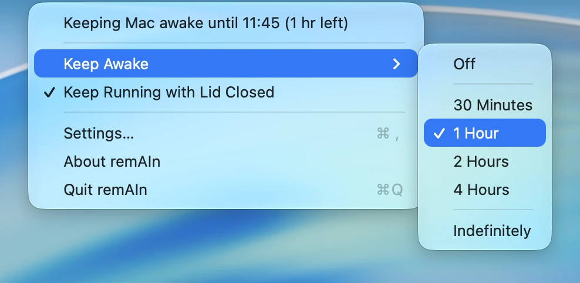
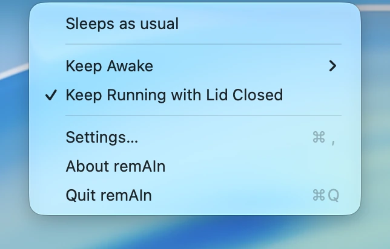
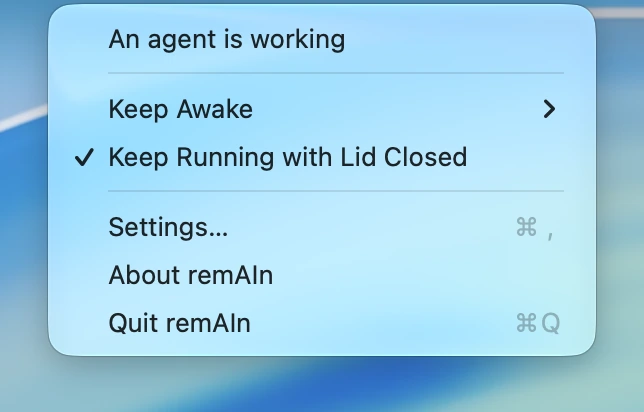
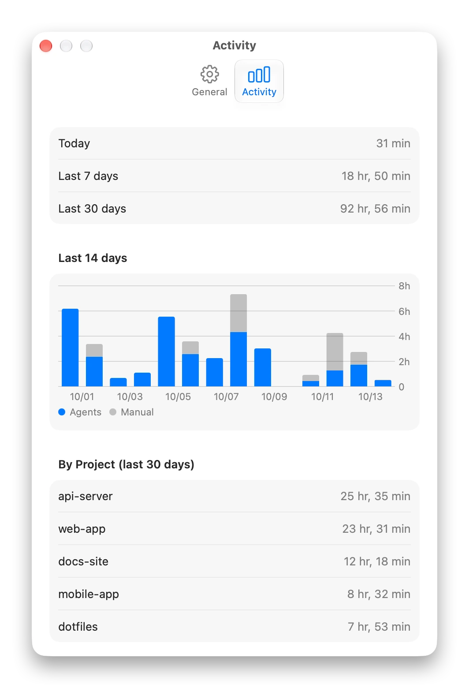
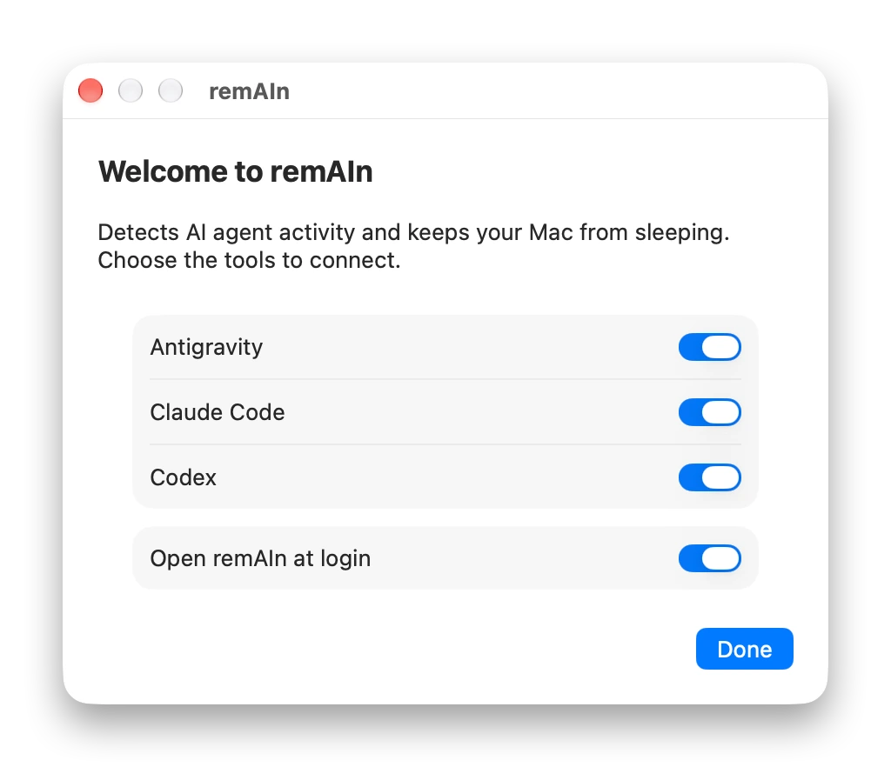
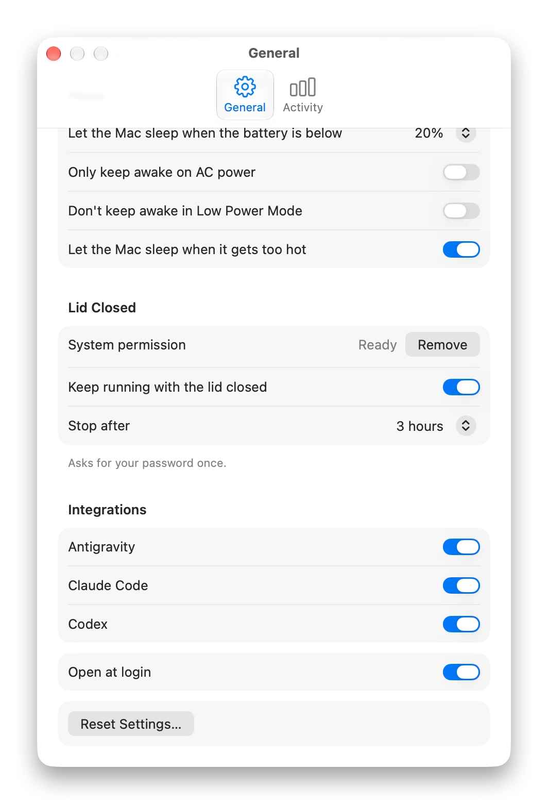

<div align="center">


# remAIn

**Keeps your Mac awake only while your AI coding agents work.**

A small macOS menu bar app that follows Claude Code, Codex and Antigravity.<br>
When they work, your Mac stays awake. When they stop, it sleeps as usual.

[](#install)
[](https://github.com/haruhito767676/remain/releases/latest)
[](#license)

[**Download**](https://github.com/haruhito767676/remain/releases/latest) · [日本語](README.ja.md) · [Technical spec (Japanese)](SPEC.md)

<br>

<picture>
  <source media="(prefers-color-scheme: dark)" srcset="docs/media/shot-menu-submenu-dark-en.webp">
  
</picture>

</div>

<!-- Demo video goes here once it exists. -->

---

## Why

Long agent runs get cut off when your Mac idles to sleep. A plain "stay awake" switch fixes that, but leaves the Mac awake long after the agent has finished, and you have to remember to turn it off. remAIn watches your agents instead, so the Mac is awake exactly while they work.

## What remAIn does

### Awake while agents work, asleep when they don't

<table>
<tr>
<td align="center">
<picture>
  <source media="(prefers-color-scheme: dark)" srcset="docs/media/shot-menu-idle-dark-en.webp">
  
</picture>
<br><sub>Nothing is running: the Mac sleeps as usual.</sub>
</td>
<td align="center">
<picture>
  <source media="(prefers-color-scheme: dark)" srcset="docs/media/shot-menu-working-dark-en.webp">
  
</picture>
<br><sub>An agent is working: the Mac stays awake.</sub>
</td>
</tr>
</table>

Claude Code, Codex and Antigravity are connected through their hooks, so remAIn knows when a session starts, works, waits for you and ends. Several sessions at once are fine. Pressing Esc or closing the tool is noticed too, so an interrupted agent never pins your Mac awake. Anything else can be followed with `remain run -- <command>`.

### Keep awake by hand

Turn it on from the menu for 30 minutes, 1, 2 or 4 hours, or without a limit. The time left is shown in the menu, and clicking it ends the hold.

### Lid closed, still running

Close the lid and the agent keeps going. When the work is over, the Mac goes to sleep. This needs your password once to set up, and it is built to fail safe: a watchdog restores normal sleep even if remAIn crashes, and it stops on its own for heat, low battery or a time limit (3 hours by default). Off by default.

### Guards for battery and heat

remAIn lets the Mac sleep when the battery runs low, when it is on battery power, in Low Power Mode, or when it gets too hot, and tells you why. It resumes by itself once the condition clears.

### Notifications and actions

Get told when a task finishes or needs your input. Optionally turn the display off or put the Mac to sleep once everything is done.

### Activity

See how long your Mac was kept awake, per day and per project. It is stored only on your Mac and deleted after 90 days.

<p align="center">
<picture>
  <source media="(prefers-color-scheme: dark)" srcset="docs/media/shot-settings-activity-dark-en.webp">
  
</picture>
</p>

---

## Install

1. Download `remAIn-v1.0.0.zip` from [Releases](https://github.com/haruhito767676/remain/releases/latest), unzip it and move remAIn to Applications.
2. remAIn is a free app made by an individual and is **not signed** by Apple, so macOS shows a warning the first time. Open *System Settings → Privacy & Security*, scroll down, choose **Open Anyway** and confirm with Touch ID or your password. You only need to do this once.
3. A welcome window offers to connect the tools it finds. You can change this later under *Settings → Integrations*.

<p align="center">
<picture>
  <source media="(prefers-color-scheme: dark)" srcset="docs/media/shot-welcome-dark-en.webp">
  
</picture>
</p>

Requires macOS 14 or later.

## Supported tools

| Tool | How it is followed |
| --- | --- |
| Antigravity | Hooks in `~/.gemini/config/hooks.json`. Its stop button fires no hook and leaves no trace, so a run that goes quiet for 5 minutes is considered over, unless it said a background command is still running. |
| Claude Code | Hooks in `~/.claude/settings.json` (CLI, desktop app and VS Code extension). Esc and closing the tool are detected. |
| Codex | Hooks in `~/.codex/hooks.json` (CLI and desktop app). Codex asks you to review and trust them first, and starts hooks in the conversation's working folder: if that folder does not exist (the desktop app's placeholder "New project"), every hook fails with `No such file or directory`, so open a real folder. |
| anything else | `remain run -- <command>` holds while the command runs. |

Your existing settings are kept: remAIn only adds and removes its own entries, and writes a one-time backup next to each file (for example `settings.json.remain-backup`). If the app is moved, its hooks are re-pointed automatically at launch. `remain doctor` shows what is connected and what is not.

<p align="center">
<picture>
  <source media="(prefers-color-scheme: dark)" srcset="docs/media/shot-settings-bottom-dark-en.webp">
  
</picture>
</p>

## Privacy

remAIn never connects to the internet, has no accounts and no analytics, and has no third-party dependencies. The app, the `remain` command and the hooks talk to each other over a Unix socket that only your user can open. History keeps project folder names, never full paths or prompts, and expires after 90 days. The only link in the app is the repository link in About, which opens only if you click it.

## Reset and uninstall

*Settings → Reset Settings…* (or `remain reset` in a terminal) takes back everything remAIn put on the Mac and returns it to its first-launch state: its own entries in each tool's hooks file (yours are left alone), the lid-closed permission and watchdog (macOS asks for your password), the login item, saved settings and history. To uninstall, reset, quit remAIn and move the app to the Trash.

## CLI

```sh
remain status
remain on [minutes]      # keep awake by hand
remain off
remain run -- <command>  # hold while any command runs (builds, downloads, other agents)
remain doctor            # what is connected, what is not
remain install-hooks     # same as switching a tool on under Settings → Integrations
```

<details>
<summary>Settings in detail</summary>

<br>

- **Integrations**: each switch writes or removes remAIn's hooks in that tool's config. A tool whose hooks point at another copy of remAIn shows *Needs repair* (also fixed automatically at launch).
- **Release automatically after no activity for**: a safety net. Interruptions and exits of an agent are detected on their own; this only matters for a session that goes quiet for any other reason. Antigravity has its own 5-minute rule.
- **Keep the display on while preventing sleep**: only extends a hold that is already active (an agent working, or Keep Awake); on its own it does nothing. With the lid closed the display is always switched off.
- **Power**: when a limit stops the hold (battery below the threshold, battery power, Low Power Mode, heat), remAIn lets the Mac sleep and tells you why, and resumes by itself once the condition clears. The battery limit resumes 5 points above the threshold so it does not flap.
- **When all tasks are done**: the chosen action (turn the display off, sleep) runs 10 seconds after the last task ends and is skipped if you start new work or if the work was shorter than "Only for work that took longer than".
- **Battery and lid** settings are hidden on Macs without a battery.
- **Lid closed**: needs your password once to set up. It adds one narrow `sudoers` rule that allows only `pmset disablesleep 0|1` (checked with `visudo` first) and a launchd watchdog that turns sleep back on if remAIn stops refreshing its heartbeat. It also needs a network connection to be useful (tether on the move).

</details>

<details>
<summary>How it works</summary>

<br>

```
Claude Code ──hook (JSON on stdin)──▶ remain hook ──Unix socket──▶ remAIn.app
                                                                      │
                                         WakeEngine (pure state machine)
                                                                      │
                                              IOPMAssertion (system sleep)
```

Each tool's hook events are turned into one small set of signals (a session starts, works, waits, finishes or is interrupted), and a pure state machine decides whether the Mac should stay awake. Interruptions are found per tool: Claude Code through its process and its transcript, Codex through its Interrupt hook, Antigravity through a quiet timeout. The full specification (architecture, event model, lid-closed safety, data files) is in [SPEC.md](SPEC.md), in Japanese.

</details>

<details>
<summary>Build from source</summary>

<br>

```sh
./scripts/build-app.sh
open build/remAIn.app
```

The app is ad-hoc signed. For development:

```sh
swift build
swift test
```

Requires macOS 14+ and Swift 6. If `swift test` fails with `no such module 'Testing'` on a Command Line Tools–only setup, install Xcode or pass the framework path:

```sh
F=/Library/Developer/CommandLineTools/Library/Developer/Frameworks
swift test -Xswiftc -F$F -Xlinker -F$F -Xlinker -rpath -Xlinker $F
```

The screenshots can be regenerated without touching your real history: `scripts/make-demo-data.swift` writes a sample history, and `REMAIN_SUPPORT_DIR` points the app at it. `promo/process-shots.sh` turns raw screenshots into the files used here.

The version lives in one place, `Sources/RemainCore/Version.swift`. To release, bump it, commit and tag `v<version>`: `.github/workflows/release.yml` tests, builds and attaches `remAIn-v<version>.zip` to a GitHub release, using `docs/release/v<version>.md` as the release notes.

The app icon is drawn in code (`scripts/make-icon.swift`, plain CoreGraphics) and committed as `Resources/AppIcon.icns`.

</details>

## License

MIT
