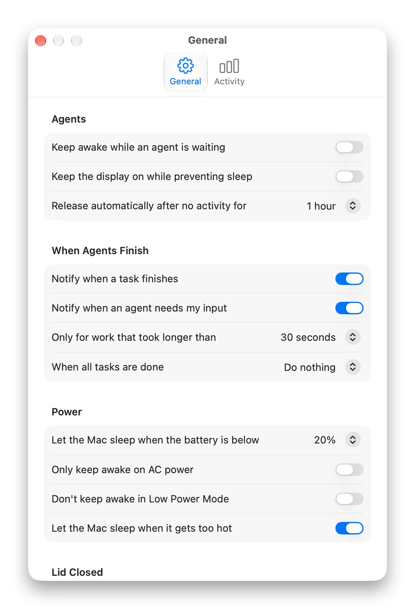
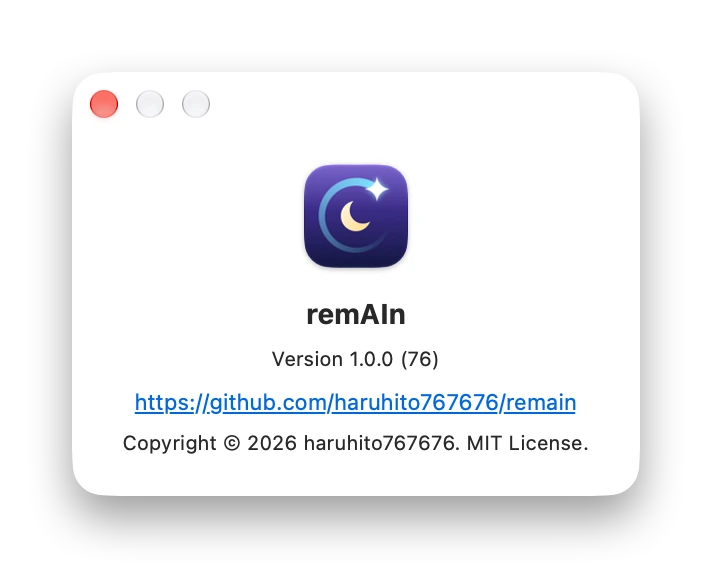

<div align="center">


# remAIn

**Keeps your Mac awake only while AI agents work.**

A small macOS menu bar app that notices when your AI agents are working and keeps your Mac awake.<br>
When they stop, it sleeps as usual: no more runs cut off by sleep, and no Mac left awake for hours.

[](#requirements)
[](https://github.com/haruhito767676/remain/releases/latest)
[](#license)

[**Download**](https://github.com/haruhito767676/remain/releases/latest) · [Website](https://haruhito767676.github.io/remain/) · [日本語](README.ja.md) · [Technical spec (Japanese)](SPEC.md)

</div>

<br>

https://github.com/user-attachments/assets/f4a5c86b-195d-47c4-9ac9-018d58636049

---

## Why remAIn

An AI agent can work for minutes or hours on its own. Your Mac doesn't know that.

- **Sleep cuts the run.** Let the Mac sleep, and a long task stops halfway.
- **`caffeinate` doesn't know when to stop.** Putting it in front of a command keeps the Mac awake, but only as long as you start and end it by hand. Forget it, and the Mac stays awake all night and runs the battery down.
- **Not every agent is a command.** IDEs and desktop apps don't run as a command, so tricks like `caffeinate` can't reach them.

remAIn follows the agent itself: awake while it works, and back to sleeping as usual the moment it is done, stopped halfway or gone.

## What remAIn does

### Awake while agents work, asleep when they don't

<p align="center">

</p>

<table>
<tr>
<td align="center">
<picture>
  <source media="(prefers-color-scheme: dark)" srcset="docs/media/shot-menu-idle-dark-en.webp">
  
</picture>
<br><sub>Nothing is running: the Mac sleeps as usual.</sub>
</td>
<td align="center">
<picture>
  <source media="(prefers-color-scheme: dark)" srcset="docs/media/shot-menu-working-dark-en.webp">
  
</picture>
<br><sub>An agent is working: the Mac stays awake.</sub>
</td>
</tr>
</table>

Each agent reports when it starts, works, waits for you and finishes, and remAIn holds the Mac awake for exactly that long. Several agents at once are fine. If you stop one halfway, remAIn notices, so an interrupted agent never keeps your Mac awake.

<p align="center">

</p>

### Keep awake by hand

For anything remAIn can't see, turn it on from the menu for 30 minutes, 1, 2 or 4 hours, or without a limit. The time left is shown in the menu, and clicking it ends the hold. From a terminal, `remain run -- <command>` keeps the Mac awake for as long as a command runs.

<p align="center">
<picture>
  <source media="(prefers-color-scheme: dark)" srcset="docs/media/shot-menu-submenu-dark-en.webp">
  
</picture>
</p>


### Lid closed, still running

Close the lid and the agent keeps going. When the work is over, the Mac goes to sleep. It needs your password once to set up, and it is built to fail safe: a watchdog restores normal sleep even if remAIn crashes, and it stops on its own for heat, low battery or a time limit (3 hours by default). Off by default.

<p align="center">

</p>

### Never drains a battery in a bag

remAIn lets the Mac sleep when the battery runs low, when it is on battery power, in Low Power Mode, or when it gets too hot, and tells you why. It resumes by itself once the condition clears.

### Know when they're done

Get a notification when a task finishes, when an agent needs your input, or when one stops unexpectedly (it crashed, or its window was closed, so remAIn lets go of your Mac). Stopping an agent yourself, with Esc, stays quiet. When everything is done, remAIn can also turn the display off or put the Mac to sleep.

<p align="center">

</p>

### See where the time went

The Activity tab shows how long your Mac was kept awake, per day and per project. It is stored only on your Mac and deleted after 90 days.

<p align="center">
<picture>
  <source media="(prefers-color-scheme: dark)" srcset="docs/media/shot-settings-activity-dark-en.webp">
  
</picture>
</p>

### And more

- **Connects in a click.** A welcome window offers to connect the agents it finds, and each one has a switch in Settings. Your existing settings are kept.
- **Fixes itself.** If you move the app, the connections are re-pointed at launch.
- **Quiet by default.** The display may sleep, because agents don't need a lit screen.
- **Private by design.** No network, no account, no analytics. See [Privacy](#privacy).
- **Undoable.** One button removes everything remAIn added to your Mac. See [Reset and uninstall](#reset-and-uninstall).
- **English and Japanese**, following your system language.

### Screens

<table>
<tr>
<td width="50%" align="center">
<picture>
  <source media="(prefers-color-scheme: dark)" srcset="docs/media/shot-welcome-dark-en.webp">
  
</picture>
</td>
<td width="50%" align="center">
<picture>
  <source media="(prefers-color-scheme: dark)" srcset="docs/media/shot-settings-top-dark-en.webp">
  
</picture>
</td>
</tr>
<tr>
<td align="center"><sub>A short welcome connects your agents</sub></td>
<td align="center"><sub>Settings</sub></td>
</tr>
<tr>
<td width="50%" align="center">
<picture>
  <source media="(prefers-color-scheme: dark)" srcset="docs/media/shot-settings-bottom-dark-en.webp">
  
</picture>
</td>
<td width="50%" align="center">
<picture>
  <source media="(prefers-color-scheme: dark)" srcset="docs/media/shot-about-dark-en.webp">
  
</picture>
</td>
</tr>
<tr>
<td align="center"><sub>Lid closed, integrations and reset</sub></td>
<td align="center"><sub>About</sub></td>
</tr>
</table>

## Install

1. Download `remAIn-v1.1.0.zip` from [Releases](https://github.com/haruhito767676/remain/releases/latest), unzip it and move remAIn to Applications.
2. remAIn is a free app made by an individual and is **not signed** by Apple, so macOS shows a warning the first time. Open *System Settings → Privacy & Security*, scroll down, choose **Open Anyway** and confirm with Touch ID or your password. You only need to do this once.
3. A welcome window opens. Choose the agents to connect, and decide whether remAIn opens at login (it has to be running to notice your agents).

To build it yourself, see [Development](#development).

### Requirements

| Item | Details |
|---|---|
| macOS | 14 (Sonoma) or later. Apple silicon and Intel. |
| Agents | At least one of the [supported agents](#supported-agents), or any command you start with `remain run`. |

## How to use

1. Connect your agents in the welcome window. You can switch each one on or off later under *Settings → Integrations*.
2. Work as usual. The menu bar icon shows what remAIn is doing: a sparkle while an agent works, a cup while it keeps the Mac awake for another reason, an hourglass while an agent waits for you, and a moon when the Mac may sleep.
3. For a one-off, use *Keep Awake* in the menu. For a night shift, set up *Keep Running with Lid Closed* once under *Settings → Lid Closed*.

### Notes

- remAIn has to be running to notice your agents. Turn on *Open remAIn at login* and forget about it.
- Settings you don't need to touch: *Release automatically after no activity for* is only a safety net, and *Keep the display on while preventing sleep* does nothing on its own.
- On a Mac without a battery, the battery and lid settings are hidden.
- Lid-closed mode is only useful with a network connection (tether on the move).

## Supported agents

| Agent | How it is followed |
|---|---|
| Antigravity (Google) | Hooks in `~/.gemini/config/hooks.json`. Its stop button fires no hook and leaves no trace, so a run that goes quiet for 5 minutes is considered over, unless it said a background command is still running. |
| Claude Code (Anthropic) | Hooks in `~/.claude/settings.json` (CLI, desktop app and VS Code extension). Pressing Esc and closing it are detected. |
| Codex (OpenAI) | Hooks in `~/.codex/hooks.json` (CLI and desktop app). Codex asks you to review and trust them first, and starts hooks in the conversation's working folder: if that folder does not exist (the desktop app's placeholder "New project"), every hook fails with `No such file or directory`, so open a real folder. |
| Any command | `remain run -- <command>` holds while the command runs. |

remAIn only adds and removes its own entries, and writes a one-time backup next to each file (for example `settings.json.remain-backup`). `remain doctor` shows which agents are connected.

## FAQ

**Does it connect to the internet?** No. See [Privacy](#privacy).

**Why does macOS warn me about the app?** remAIn is a free app by an individual and is not signed by Apple. See [Install](#install): you only need to allow it once.

**What if an agent crashes, or I close its window?** remAIn notices that the process is gone (or has been quiet for too long) and lets the Mac sleep again. If the run lasted long enough, it tells you the agent stopped unexpectedly. If you stop an agent yourself with Esc, nothing is shown.

**How is this different from `caffeinate`?** `caffeinate` holds for as long as the command you put it in front of, and you have to remember to start it. remAIn follows the agent itself, including IDEs and desktop apps, and lets go on its own.

**Can it drain the battery in a bag?** It lets the Mac sleep when the battery is low, when it is on battery power, in Low Power Mode or when it is hot. Lid-closed mode is off by default and has a time limit.

## What remAIn touches

remAIn asks for as little as it can.

| What | Why |
|---|---|
| Each agent's hooks file | The connection. Only remAIn's own entries are added, and removed again when you switch the agent off. |
| Notifications | Optional. Tells you when a task finishes or needs your input. |
| Login item | Optional. Opens remAIn at login. |
| A `sudoers` rule and a launchd watchdog | Only if you set up lid-closed mode, with your password. The rule allows exactly `pmset disablesleep 0` and `pmset disablesleep 1` and nothing else, and is checked with `visudo` before it is installed. |
| The network | Never used. |

## Privacy

remAIn has no server, no account, no analytics and no third-party dependencies, and never connects to the internet. The app, the `remain` command and the hooks talk to each other over a Unix socket that only your user can open. History keeps project folder names, never full paths or prompts, and is deleted after 90 days. The only link in the app is the repository link in About, which opens only if you click it.

## Reset and uninstall

*Settings → Reset Settings…* (or `remain reset` in a terminal) takes back everything remAIn put on the Mac and returns it to its first-launch state: its own entries in each agent's hooks file (yours are left alone), the lid-closed permission and watchdog and the `remain` command link (macOS asks for your password), the login item, saved settings and history. To uninstall, reset, quit remAIn and move the app to the Trash.

## CLI

To use the `remain` command in Terminal, open *Settings → Command Line* and press **Install…** (it asks for your password once, and adds a link in `/usr/local/bin`).

```sh
remain status
remain on [minutes]      # keep awake by hand
remain off
remain run -- <command>  # hold while a command runs (builds, downloads, anything)
remain doctor            # which agents are connected
remain install-hooks     # same as switching an agent on under Settings → Integrations
```

## Development

```sh
./scripts/build-app.sh   # builds build/remAIn.app (ad-hoc signed)
swift build
swift test
```

Requires macOS 14+ and Swift 6. If `swift test` fails with `no such module 'Testing'` on a Command Line Tools–only setup, install Xcode or pass the framework path:

```sh
F=/Library/Developer/CommandLineTools/Library/Developer/Frameworks
swift test -Xswiftc -F$F -Xlinker -F$F -Xlinker -rpath -Xlinker $F
```

The full specification (architecture, event model, lid-closed safety, data files) is in [SPEC.md](SPEC.md), in Japanese.

<details>
<summary>Settings in detail</summary>

<br>

- **Integrations**: each switch writes or removes remAIn's hooks in that agent's config. An agent whose hooks point at another copy of remAIn shows *Needs repair* (also fixed automatically at launch).
- **Release automatically after no activity for**: a safety net. Interruptions and exits of an agent are detected on their own; this only matters for a session that goes quiet for any other reason.
- **Keep the display on while preventing sleep**: only extends a hold that is already active; on its own it does nothing. With the lid closed the display is always switched off.
- **Power**: when a limit stops the hold (battery below the threshold, battery power, Low Power Mode, heat), remAIn lets the Mac sleep and tells you why, and resumes by itself once the condition clears. The battery limit resumes 5 points above the threshold so it does not flap.
- **When all tasks are done**: the chosen action (turn the display off, sleep) runs 10 seconds after the last task ends and is skipped if you start new work or if the work was shorter than *Only for work that took longer than*.
- **Lid closed**: adds one narrow `sudoers` rule and a launchd watchdog that turns sleep back on if remAIn stops refreshing its heartbeat.

</details>

<details>
<summary>How it works</summary>

<br>

```
agent ──hook (JSON on stdin)──▶ remain hook ──Unix socket──▶ remAIn.app
                                                                │
                                   WakeEngine (pure state machine)
                                                                │
                                        IOPMAssertion (system sleep)
```

Each agent's hook events are turned into one small set of signals (a session starts, works, waits, finishes or is interrupted), and a pure state machine decides whether the Mac should stay awake. Interruptions are found in whatever way each agent allows: its process and transcript, a dedicated hook, or a quiet timeout. See [SPEC.md](SPEC.md).

</details>

<details>
<summary>Releases and the screenshots</summary>

<br>

The version lives in one place, `Sources/RemainCore/Version.swift`. To release, bump it, commit and tag `v<version>`: `.github/workflows/release.yml` tests, builds and attaches `remAIn-v<version>.zip` to a GitHub release, using `docs/release/v<version>.md` as the release notes.

The screenshots can be regenerated without touching your real history: `scripts/make-demo-data.swift` writes a sample history, `REMAIN_SUPPORT_DIR` points the app at it, and `promo/process-shots.sh` turns raw screenshots into the files used here. The app icon is drawn in code (`scripts/make-icon.swift`) and committed as `Resources/AppIcon.icns`.

</details>

## License

[MIT](LICENSE)

remAIn is an independent project and is not affiliated with Anthropic, Google or OpenAI. Antigravity, Claude Code, Codex and ChatGPT are trademarks of their respective owners.
